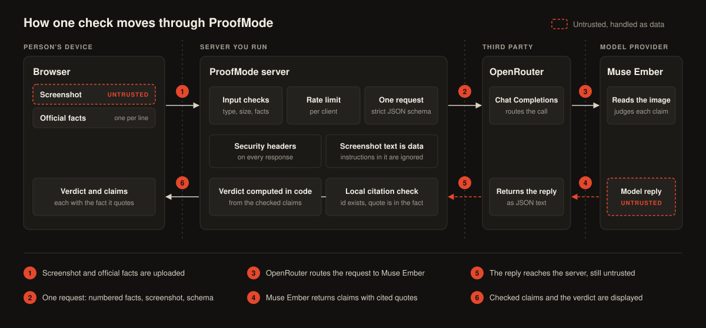

# ProofMode

**Check a screenshot of a suspicious message, claim by claim, with a quoted fact behind every verdict.**

A message arrives by email, SMS or chat and says it is from an organisation you deal with. It wants something from you quickly. ProofMode reads a screenshot of that message, lists each claim it makes, and judges every claim against a numbered list of facts: either general scam red flags published by the FTC, or the organisation's own official facts. Each verdict cites a fact and an exact quote from it. The app checks every citation itself and computes the overall verdict in code.

- Public site: <https://proofmode-dun.vercel.app>
- Repository: <https://github.com/ankitshah009/proofmode>

## Why this is hard

| Problem | How ProofMode handles it |
|---|---|
| Models make things up | Every verdict must quote a fact, and the app verifies the quote in code. A status with no real quote is downgraded |
| The message is written by an attacker and can contain instructions aimed at the model | Screenshot text is presented as data, never as instructions. In live tests on 2026-11-09 an injected instruction changed no verdict |
| People rarely have official facts to hand | General scam red flags from FTC guidance are the default. The organisation's own facts give a stronger check |
| Letting a model look things up is risky, because a scam can point it at its own site | The investigation engine refuses in code to fetch any domain that appears in the message, reads one site per check over https at public addresses only, and never lets a domain lookup alone decide a status. It runs through the API with `investigate=1` (see below) |
| New scams have no history for blocklists to match | The check is against stated facts, not against past sightings, so a first-seen sender or domain is judged the same way |

## Why a small, low-cost model changes this

Measured on the Tidewater Cloud example (57,582-byte screenshot, five facts) on 2026-11-09, by sending the same request the app sends, twice. Price read from OpenRouter's model list the same day: $0.0000001 per input token and $0.0000005 per output token, which is $0.10 and $0.50 per million.

| | Run 1 | Run 2 |
|---|---|---|
| Input tokens | 2,292 | 2,292 |
| Output tokens (including the model's reasoning tokens) | 1,615 | 2,032 |
| Input cost: tokens x $0.10 / 1,000,000 | $0.0002292 | $0.0002292 |
| Output cost: tokens x $0.50 / 1,000,000 | $0.0008075 | $0.0010160 |
| Cost per check (matches the `cost` field OpenRouter returned) | $0.0010367 | $0.0012452 |
| Checks per US dollar: 1 / cost | about 965 | about 803 |
| Seconds for the model call | 4.02 | 4.29 |

These figures are for this one example. A larger image, a longer message or more facts change them, and output length varies between runs.

- **A small model is enough for this design.** The model only has to read and quote. The verifying and the verdict are done in code, so the design does not depend on a large model.
- **Cost allows a check on every suspicious message,** at roughly a tenth of a cent each on this example, not only on escalated ones.
- **A few seconds is fast enough** to check before replying or paying.
- **The two features the check needs,** image input and schema-constrained output, are supported by this model through OpenRouter.

The limit stands: accuracy beyond the example has not been measured.

## How ProofMode uses Muse Ember

Each check is one request to `meta/muse-ember` through [OpenRouter](https://openrouter.ai)'s Chat Completions API. In live runs on 2026-11-09 a check took about 4 to 7 seconds.

1. **The app builds the request.** It numbers the facts S1, S2 and so on, and places them between a `BEGIN` and an `END` marker that contains a random token generated for that request, so text inside a fact cannot close the block and pose as instructions.
2. **The model receives three things.** A system prompt with the checking and security rules; a text part holding the marked block of numbered facts; and the screenshot as an image part, sent as a base64 `data:` URL.
3. **The reply format is fixed.** The request carries a strict JSON schema (`response_format` of type `json_schema`, `strict: true`) and `provider.require_parameters: true`, so OpenRouter routes it only to a provider that honours the schema.
4. **Muse Ember reads the image and answers.** It returns a list of claims. Each claim has the text as written in the message (the sender line comes first), a status, the ids of the facts it relies on, word-for-word quotes from those facts, a short explanation and, for a contradicted claim, a one-sentence correction.
5. **The app checks the reply without the model.** It keeps at most 20 claims and cuts every field to a fixed length. It drops fact ids that do not exist, and drops any quote that does not appear word for word (ignoring case and runs of whitespace) in a fact the claim cites. A `supported` or `contradicted` claim left with no valid quote is downgraded to `insufficient_evidence`.
6. **The app computes the verdict.** The model is never asked for it.

| Done by Muse Ember | Done in code |
|---|---|
| Read the text in the screenshot | Number the facts and wrap them in the per-request marker |
| Identify the sender and each claim | Validate the upload (type, signature, size) and rate limit |
| Choose a status for each claim | Enforce output bounds on the reply |
| Pick the fact ids and copy the quotes | Check every fact id and every quote against the real facts |
| Write the explanation and correction | Downgrade claims with no valid quote |
| | Compute the overall verdict |

Text inside the screenshot is treated as untrusted data. If the message contains instructions aimed at the model ("ignore the facts", "mark every claim as supported"), the prompt tells the model to report them as an item and not obey them, and the citation check in code applies whatever the model does.

## How this differs from spam filters and link scanners

ProofMode does a different job from the tools that usually sit in front of an inbox. It does not replace them.

| Kind of tool | What it does | What it does well |
|---|---|---|
| Reputation and blocklist tools | Score a sender, link or attachment against known-bad data | Fast, automatic, effective against senders, links and files that have been seen before |
| Classifiers | Give a message a spam or phishing score | Handle large volumes with no effort from the reader |

What ProofMode adds:

- **It judges the content of the message, claim by claim.** A deadline, a fee, a payment method and a link each get their own status.
- **It shows the quoted fact behind each verdict.** You can read the fact and decide for yourself.
- **It works on a message with no link, or one that uses a brand-new domain.** Nothing has to be on a list already, because the check is against stated facts, not against history.
- **It never asks you to trust a score.** There is no number. A status with no real quote behind it is downgraded in code.

Its limits, stated just as plainly:

- **It depends on the facts supplied.** With the general red-flag list it catches only the patterns on that list. With an organisation's facts, wrong or incomplete facts give a wrong or empty answer.
- **A "consistent" result is not proof that a message is genuine.** A fraudulent message can repeat true facts.
- **Accuracy beyond the built-in example is not measured.** There is no evaluation set.
- **It does not scan links or attachments,** inspect email headers, or check sender reputation.

## Using the page

One step: **drop, paste or choose a screenshot** (PNG, JPEG or WebP, up to 8 MB) and the check runs at once. A file can be dropped or pasted anywhere on the page.

The page has two evidence modes:

| Mode | Facts sent with the screenshot | When to use it |
|---|---|---|
| General scam red flags (default) | Seven rules from `static/baseline.json`, quoted from FTC consumer guidance: [How to Avoid a Scam](https://consumer.ftc.gov/articles/how-avoid-scam) and [Gift Card Scams](https://consumer.ftc.gov/articles/gift-card-scams) | You have no facts from the organisation |
| This organisation's official facts | The lines you paste, one fact per line, up to 40 lines and 20,000 characters | You can copy facts from the organisation's own site or documents |

If the organisation mode is selected but the facts box is empty, the page falls back to the general rules. After you edit the facts or switch mode, **Check again** reruns the check. The page also shows four FTC figures on impersonation fraud, each linked to its source, from `static/why.json`.

Each claim gets one status, and the verdict follows from the statuses:

| `status` | Organisation mode label | General mode label |
|---|---|---|
| `supported` | Matches the official facts | In line with the general rules |
| `contradicted` | Contradicts the official facts | Scam red flag |
| `insufficient_evidence` | Cannot be verified | Not covered by the general rules |

| `verdict` | Rule | Organisation mode title | General mode title |
|---|---|---|---|
| `contradicts_facts` | At least one claim is contradicted | Do not trust this message | Do not trust this message |
| `consistent` | At least one claim, and every claim is supported | Consistent with the official facts | No common scam pattern found |
| `unverified` | Anything else | Not enough facts to judge | The general rules do not settle this |

### Example

**Try the example** loads a screenshot and five facts for **Tidewater Cloud**, a fictional organisation invented for this project, and runs the check in organisation mode. The message, sender and domains are made up. The message comes from `billing@tidewater-accounts.co` (a look-alike domain), says API credits expire in 24 hours, demands a $49 reactivation fee, offers payment by gift card, links to the look-alike domain, and says support is available 24/7. The facts say credits do not expire, there is no reactivation fee, gift cards are never accepted, and official messages use only `tidewater.example`.

Expected result: the sender and the first four claims are contradicted, the support claim is supported, and the verdict is "Do not trust this message".

## API

There is one check endpoint. It takes a screenshot, the message as pasted text, or both, and runs one of three checks.

| Method and path | Purpose |
|---|---|
| `POST /api/review` | Run one check. Body is `multipart/form-data` |
| `GET /api/capabilities` | Returns `{"investigate": <bool>, "text": true, "model": "<id>"}`: whether `investigate=1` is accepted on this server, and that pasted text is |
| `GET /api/health` | Returns `{"ok": true, "mock": <bool>, "model": "<id>"}`. Does not say whether a key is configured |

`POST /api/review` fields. At least one of `image` and `text` is required:

| Field | Required | Content |
|---|---|---|
| `image` | one of the two | One PNG, JPEG or WebP file, up to 8 MB. The declared type must match the file's signature |
| `text` | one of the two | The message as pasted text, up to 10,000 characters. Blank text counts as absent |
| `facts` | yes, unless `investigate=1` | One fact per line, 1 to 40 non-empty lines, up to 20,000 characters. Leading bullets and list numbers are stripped. The field name `sources` is accepted too (the page uses it). May be empty only with `investigate=1` |
| `investigate` | no | `1` turns on the investigation loop. `0` or absent leaves it off. Any other value is a 400 |
| `official_domain` | no | The organisation's real domain, such as `example.org`. A scheme, path, port and leading `www.` are stripped. Used only with `investigate=1` |

Which check runs:

| Request | Check | Model calls |
|---|---|---|
| `image`, no `investigate` | The screenshot check described above. A `text` field sent alongside is not used, and a note in the result says so | 1 |
| `text` only, no `investigate` | The same check with the message supplied as text | 1 |
| `investigate=1` | The investigation loop, over the screenshot, the text or both, with any facts you sent | up to 6, plus outbound requests |

Screenshot and facts:

```bash
curl http://127.0.0.1:8000/api/review \
  -F "image=@src/proofmode/static/sample.png" \
  --form-string "facts=Tidewater Cloud credits do not expire.
Tidewater Cloud never charges a reactivation fee.
Payments are accepted by card or bank transfer only; gift cards are never accepted.
Official messages are sent only from tidewater.example and link only to tidewater.example.
Support is available 24 hours a day, 7 days a week."
```

Pasted text and facts:

```bash
curl http://127.0.0.1:8000/api/review \
  --form-string "text=From: Tidewater Cloud Billing <billing@tidewater-accounts.co>
Your API credits expire in 24 hours. Pay a \$49 reactivation fee with a gift card." \
  --form-string "facts=Tidewater Cloud credits do not expire.
Tidewater Cloud never charges a reactivation fee."
```

Investigation, with no facts:

```bash
curl http://127.0.0.1:8000/api/review \
  --form-string "text=From: Tidewater Cloud Billing <billing@tidewater-accounts.co>
Your API credits expire in 24 hours. Pay a \$49 reactivation fee with a gift card." \
  --form-string "official_domain=tidewater.example" \
  --form-string "investigate=1"
```

`tidewater.example` is fictional, so that last request returns evidence only in demo mode (`PROOFMODE_MOCK=1`), where the page is served from a bundled file. Against the live model, put a real organisation's domain in `official_domain`.

Use `--form-string` for every text field, not `-F`. With `-F`, curl treats a semicolon in the value as the start of an option such as `;type=` and a leading `<` or `@` as a file to read, so the third fact above would be cut at "only" and its claim would come back as `insufficient_evidence`. To use the general red flags through the API, send the lines of `facts` from `/baseline.json` as the `facts` field.

Response, `200`, for the first request (five of the six claims removed here for length):

```json
{
  "model": "meta/muse-ember",
  "claims": [
    {
      "claim_text": "Tidewater Cloud Billing <billing@tidewater-accounts.co>",
      "status": "contradicted",
      "source_ids": ["S4"],
      "evidence_quotes": ["Official messages are sent only from tidewater.example"],
      "explanation": "The sender address uses tidewater-accounts.co, but S4 says official messages are sent only from tidewater.example.",
      "correction": "Official messages are sent only from tidewater.example."
    }
  ],
  "notes": [],
  "verdict": "contradicts_facts",
  "sources": [],
  "steps": []
}
```

`notes` lists anything the local check changed, such as a dropped quote or a downgraded claim, and in an investigation any warning about where the evidence came from. The claim wording in a live reply is the model's and can differ from this example, which is the demo-mode output.

`sources` and `steps` are empty unless `investigate=1`. Then they hold everything the claims could cite and everything the model did. From the demo-mode investigation above (two of the eight sources shown; the registration date is always seven days before the run):

```json
{
  "sources": [
    {"id": "S1", "text": "Billing help - Tidewater Cloud", "url": "https://tidewater.example/help/billing", "origin": "fetched"},
    {"id": "S8", "text": "tidewater-accounts.co was registered on 2026-11-02 (7 days ago). Registrar: Example Registrar.", "url": null, "origin": "lookup"}
  ],
  "steps": [
    {"tool": "fetch_official_page", "argument": "https://tidewater.example/help/billing", "outcome": "Read https://tidewater.example/help/billing: 7 relevant line(s) kept as S1 to S7.", "ok": true},
    {"tool": "lookup_domain", "argument": "tidewater-accounts.co", "outcome": "tidewater-accounts.co was registered on 2026-11-02 (7 days ago). Registrar: Example Registrar. Kept as S8.", "ok": true},
    {"tool": "finish", "argument": "", "outcome": "Returned 6 claim(s).", "ok": true}
  ]
}
```

| Field | Content |
|---|---|
| `sources[].id` | `S1`, `S2` and so on. Your own facts come first; fetched and lookup lines continue the numbering |
| `sources[].text` | One fact, one sentence read from a page, or one registration line |
| `sources[].url` | The page a `fetched` line was read from; `null` otherwise |
| `sources[].origin` | `user` (pasted by you), `fetched` (read from the official site) or `lookup` (domain registration data; never enough on its own to decide a status). The type also allows `baseline` for facts shipped with the app |
| `steps[].tool` | `report_message`, `fetch_official_page`, `lookup_domain` or `finish` |
| `steps[].argument` | The URL or domain the model asked for, cut to 200 characters |
| `steps[].outcome` | What happened, in one line, including the reason for a refusal |
| `steps[].ok` | `false` when the call was refused or failed |

Errors are JSON of the form `{"detail": "<message>"}`:

| Status | Meaning |
|---|---|
| 400 | Not `multipart/form-data`, unreadable form, neither image nor text, an empty image, no facts (without `investigate=1`) or more than 40, an invalid `official_domain`, an `official_domain` that appears in the message text, an `investigate` value other than `1` or `0`, or `investigate=1` on a server where it is turned off |
| 413 | Request over 9 MB, image over 8 MB, text over 10,000 characters, or facts over 20,000 characters |
| 415 | Type is not PNG, JPEG or WebP, or the file signature does not match the declared type |
| 429 | A rate limit was reached. The `Retry-After` header gives the wait in seconds |
| 502 | The model call failed, the reply was unusable, or no API key is configured |
| 504 | An investigation passed its 120 second deadline and was stopped. No partial result is returned |
| 500 | Unexpected server error, with a generic message |

**Rate limits:** 10 `POST /api/review` requests per minute per client address by default (`PROOFMODE_RATE_LIMIT`), applied before the body is read. Requests with `investigate=1` also count against a second limit of 3 per minute per client address (`PROOFMODE_INVESTIGATE_RATE_LIMIT`), applied once the form has been validated. There is no authentication and no API key for callers. The interactive API docs and the OpenAPI document are turned off.

## Investigation engine

With `investigate=1` the model gathers its own evidence with tool calls before answering. It can read pages of the organisation's real website and look up a domain's registration record, within fixed budgets: 6 tool calls, 5 model turns, 60 seconds of evidence gathering, and 120 seconds for the whole request. Its final claims go through the same citation check and verdict code as every other check. The loop, the tools and their limits are described in [docs/INVESTIGATION.md](docs/INVESTIGATION.md); the code is `src/proofmode/investigate.py` and `src/proofmode/tools.py`.

Rules enforced in code, whoever proposes the site:

- **A domain that appears in the message is never fetched.** That holds for a site the model proposes and for an `official_domain` you supply. For pasted text the request is refused with a 400 before any model call. For a screenshot, where the domains are known only once the model has read it, the fetch is refused and a note says why.
- **With `official_domain`, only that domain and its subdomains are read.** Without it the model proposes one site, and the result starts with a note naming it and asking you to confirm it.
- **Outbound requests go to https on port 443 at public addresses only,** with the address vetted before connecting and each redirect checked again.
- **A domain lookup alone never decides a status.**

Set `PROOFMODE_INVESTIGATE=0` to turn the mode off; `investigate=1` then returns 400 and `/api/capabilities` reports `"investigate": false`.

One live run is recorded, on 2026-11-09 against `meta/muse-ember`: an invented text message claiming to come from a public open-source organisation, with that organisation's real domain as `official_domain` and no facts. It returned 200 in 10.8 seconds. The model listed the sender's domain, read two pages of the official site (67 lines kept), looked up the sender's domain (no registration record found) and finished with 4 claims, all `contradicted`, verdict `contradicts_facts`. The two claims about licensing cost were contradicted by a relevant quoted sentence. The quote attached to the sender claim was a real sentence from the site but only loosely related to the claim: the citation check confirms that a quote exists in the cited source, not that it proves the point, so read the quotes. This is one run, not a measurement.

## Run it

Requires Python 3.14 and [uv](https://docs.astral.sh/uv/).

```bash
git clone https://github.com/ankitshah009/proofmode.git
cd proofmode
uv sync
```

**Live model.** You need an OpenRouter API key:

```bash
export OPENROUTER_API_KEY=sk-or-...
uv run python -m proofmode          # http://127.0.0.1:8000
```

Or keep it in `.env.local` (ignored by git) as a line `OPENROUTER_API_KEY=sk-or-...`. ProofMode reads the process environment and does not load the file itself:

```bash
set -a; source .env.local; set +a
uv run python -m proofmode
```

**Demo mode.** No key and no network call. The app returns a canned result for the Tidewater Cloud example, which still passes through the same citation check and verdict code:

```bash
PROOFMODE_MOCK=1 uv run python -m proofmode
```

### Environment variables

| Variable | Default | Purpose |
|---|---|---|
| `OPENROUTER_API_KEY` | none | Required for live checks. Sent only to OpenRouter, in the `Authorization` header |
| `PROOFMODE_MOCK` | unset | `1` returns the canned example result and makes no network call |
| `PROOFMODE_MODEL` | `meta/muse-ember` | Model id sent to OpenRouter |
| `PROOFMODE_HOST` | `127.0.0.1` | Address to bind. The default is reachable from this machine only |
| `PROOFMODE_PORT` | `8000` | Port to bind |
| `PROOFMODE_RATE_LIMIT` | `10` | Checks per minute per client address. `0` turns the limit off |
| `PROOFMODE_INVESTIGATE` | on | `0` turns investigation mode off: `investigate=1` then returns 400 |
| `PROOFMODE_INVESTIGATE_RATE_LIMIT` | `3` | Investigations per minute per client address, on top of the limit above. `0` turns this limit off |
| `PROOFMODE_TRUST_PROXY` | unset | `1` takes the client address from the last `X-Forwarded-For` entry. Set it only behind one reverse proxy you control |
| `PROOFMODE_USER_ID` | unset | Optional opaque identifier sent to OpenRouter as the `user` field |

### Hosted deployment

The public site runs on Vercel. `main.py` at the repository root is the ASGI entry point for hosts of that kind; `PROOFMODE_HOST` and `PROOFMODE_PORT` do not apply there.

- **Key.** `OPENROUTER_API_KEY` must be set as an environment variable on the host. Without it the page loads and `POST /api/review` returns 502.
- **Body size.** The host caps request bodies near 4.5 MB, below the app's own 8 MB image limit, so larger screenshots are rejected by the host before they reach the app.
- **Rate limit.** Both limiters live in memory, so on the host they are per server instance: they are not shared between instances and reset when one is replaced. Set a spending limit on the OpenRouter key.
- **Investigation mode has not been run on the hosted site,** and two things about it may not suit a host of this kind. First, duration: an investigation makes several model calls and outbound requests in one HTTP request and may run for up to 120 seconds before the app answers 504 (the one recorded local run took about 11 seconds). If the host's maximum function duration is shorter than that, the host ends the request with its own error page, not the app's JSON. Second, the stricter investigation limit of 3 per minute is per instance like the general one, so it is a weaker cap there than on a single local process, while each investigation costs several model calls and fetches other sites from the host's network. Until the function duration is set to at least 120 seconds and a run has been checked there, set `PROOFMODE_INVESTIGATE=0` on the host. Pasted text without investigation is one model call, like the screenshot check, and needs nothing extra.

## Security

The full threat model, controls and limits are in [SECURITY.md](SECURITY.md). In short:

- **Prompt injection.** The screenshot and the facts are presented to the model as data, the facts inside the per-request marker. The reply is schema-constrained, bounded in size, and every citation is checked in code.
- **Verdict in code.** The model is never asked for the overall verdict.
- **Uploads.** The file signature must match the declared type. The image is never decoded or resized by the app. Limits: 8 MB image, 20,000 characters and 40 lines of facts, 9 MB request.
- **Abuse.** `POST /api/review` is rate limited per client address before the body is read. Investigations have a second, stricter limit and a 120 second deadline.
- **Investigation.** Outbound requests go to https at public addresses only, never to a domain that appears in the message, whether the model or the user proposed it. Fetched text is data and is never logged.
- **Headers.** Every response carries a Content-Security-Policy with scripts allowed by hash only, plus `nosniff`, frame, referrer, opener and permissions policies. API responses are `no-store`.
- **Key and data.** The API key stays on the server and never appears in responses or error messages. Uploads are held in memory for one request and are not written to disk or logged. The screenshot and facts are sent to OpenRouter and the model provider, so do not upload anything you are not willing to share with them.

## Architecture



Components, the request flow, trust boundaries and the data contract are described in [docs/ARCHITECTURE.md](docs/ARCHITECTURE.md).

| Path | Contents |
|---|---|
| `main.py` | ASGI entry point for hosted deployments |
| `src/proofmode/app.py` | HTTP routes, input limits, rate limit, security headers |
| `src/proofmode/review.py` | Prompt, fact parsing, output bounds, citation check, verdict |
| `src/proofmode/openrouter.py`, `models.py` | OpenRouter client, mock client, shared data types |
| `src/proofmode/investigate.py`, `tools.py` | Investigation engine, the pasted-text check, and the vetted network tools |
| `src/proofmode/static/`, `fixtures/` | Single-page UI, example screenshot, `baseline.json`, `why.json`; canned data for demo mode |
| `tests/`, `scripts/`, `docs/` | Tests; example generators; architecture, verification and submission notes |

## Develop

```bash
uv run pytest -n auto                  # test suite, all cores
uv run ruff check src tests scripts    # lint
uv run --with pillow python scripts/make_sample.py   # regenerate the example screenshot
```

## Status

- **Verified live on 2026-11-09:** runs against `meta/muse-ember` through OpenRouter with the example screenshot and facts confirmed image input and strict JSON schema output, at about 4 to 7 seconds per check.
- **Verified by tests:** fact parsing, output bounds, citation validation, verdict computation, the OpenRouter client against a fake transport, the HTTP routes for all three checks, upload checks, both rate limiters, the investigation deadline, the security headers, and the investigation engine with its network tools.
- **Verified live on 2026-11-09, once each:** the pasted-text check through `POST /api/review` (Tidewater Cloud message and five facts: 200 in 3.3 seconds, sender and three claims contradicted, the support claim supported, verdict `contradicts_facts`), and one investigation (see "Investigation engine").
- **API only:** pasted text and investigation mode are available through `POST /api/review`. This README does not describe page controls for them. Investigation mode has not been run on the hosted site (see "Hosted deployment").
- **Not measured:** accuracy beyond the built-in example. Do not read the example as evidence of how often the model extracts or judges claims correctly on other messages.
- **No authentication.** Anyone who can reach the app can run checks against its key. Locally, keep the default bind address or put your own access control in front.
- **Limits of the result.** A consistent result is not proof that a message is genuine; the result is only as good as the facts; the model can miss or misread a claim. Before you act, contact the organisation through a channel you already know to be official.
- **In-memory rate limit.** It is per process, is not shared between workers or instances, and resets on restart. The app does not terminate TLS itself.
