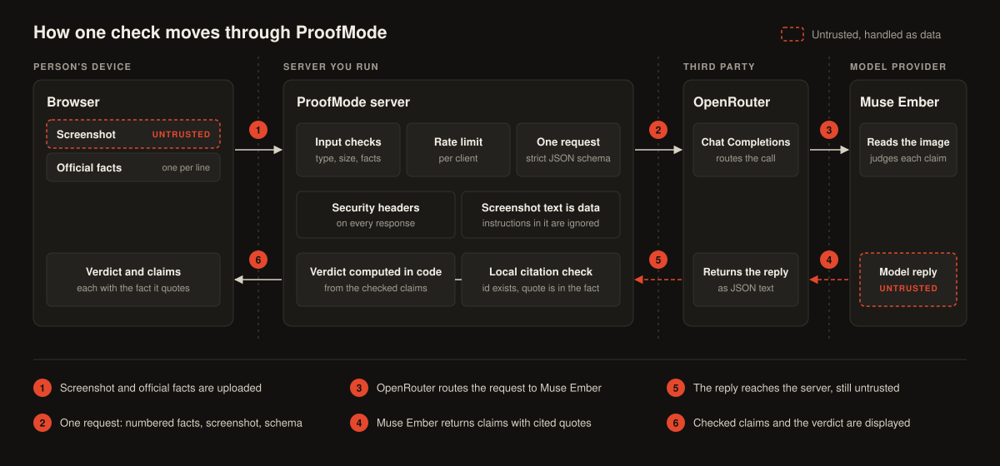
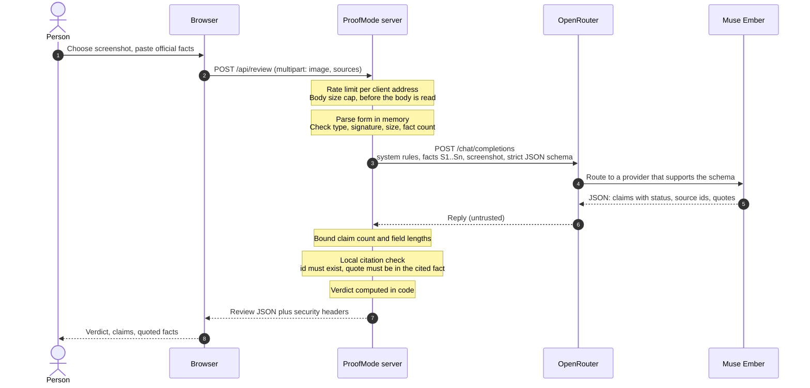

# ProofMode architecture

ProofMode is a fraud check. A person uploads a screenshot of a suspicious message and pastes the official facts of the organisation the message claims to come from. ProofMode returns each claim in the message with a status, a cited fact and an exact quote, plus an overall verdict.

The design rests on one rule: **the model proposes, the code decides.** The model reads the screenshot and proposes claims with citations. Local code checks every citation and computes the verdict.



The numbers in the diagram match the steps in [Request flow](#request-flow).

## Components

| Component | File | Responsibility |
|---|---|---|
| Page | `src/proofmode/static/index.html` | Single page with inline CSS and JavaScript. Collects the screenshot and facts, posts them, and renders the result as text nodes, never as HTML |
| Web layer | `src/proofmode/app.py` | Routes, rate limit, body and upload limits, file signature check, security headers, generic error handling |
| Review logic | `src/proofmode/review.py` | System prompt, JSON schema, fact parsing, output bounds, citation validation, verdict computation |
| Model client | `src/proofmode/openrouter.py` | One async call to OpenRouter Chat Completions, error mapping, and a mock client that returns a canned result |
| Data types | `src/proofmode/models.py` | `Source`, `Claim`, `Review` and the allowed status and verdict values |
| Entry point | `src/proofmode/__main__.py` | Starts the server on `PROOFMODE_HOST` and `PROOFMODE_PORT` with proxy header rewriting turned off |

Routes:

| Route | Purpose |
|---|---|
| `GET /` | The page |
| `GET /sample.png` | Screenshot for the built-in example (Tidewater Cloud, a fictional organisation) |
| `GET /why.json` | Background figures shown on the page, each with its source |
| `GET /api/health` | Returns `ok`, `mock` and `model`. Does not reveal whether a key is configured |
| `POST /api/review` | Runs one check |

There is no database, no cache, no session and no background work. One process serves everything.

## Request flow



Step by step, using the diagram numbers from the picture above:

**1. Upload (browser to server).** The page sends `POST /api/review` as `multipart/form-data` with two fields: `image` (the screenshot) and `sources` (the pasted facts; the name `facts` is accepted as well).

Before any of the body is read, the server:

- applies the rate limit for the client address and answers 429 with `Retry-After` when it is exceeded;
- rejects a `Content-Length` above 9 MB with 413.

Then it reads the form entirely in memory, with a hard cap on the stream so that a body sent without a length is cut off at the same 9 MB. It checks that:

- the declared image type is PNG, JPEG or WebP (415 otherwise);
- the image is not empty (400) and not larger than 8 MB (413);
- the leading bytes of the file match the declared type (415 otherwise);
- the facts are no longer than 20,000 characters (413);
- there is at least one fact and no more than 40 (400 otherwise).

Facts are split one per non-empty line, leading list markers are stripped, and each fact gets an id: `S1`, `S2` and so on.

**2. One request (server to OpenRouter).** `run_review` builds a single Chat Completions request:

- a system message that defines the task, the security rules and the checking rules;
- a user message with two parts: a text part holding the numbered facts inside a block delimited by a random marker generated for this request, and an `image_url` part holding the screenshot as a base64 data URL;
- `response_format` with a strict JSON schema (`proofmode_review`);
- `provider.require_parameters: true`, so the request is only routed to an endpoint that supports structured output.

The API key is added here, in the `Authorization` header. There are no retries and no second model.

**3. Routing (OpenRouter to the model).** OpenRouter forwards the request to a provider of `meta/muse-ember`.

**4. Model reply.** The model reads the screenshot, reports the sender line first, extracts the claims the message makes (including every link the reader is pointed to), and returns a JSON object with a `claims` array.

**5. Reply reaches the server.** The reply is treated as untrusted. In order:

1. *Shape.* The content must be a JSON object with a `claims` list whose items match the `Claim` type. Anything else is a 502 with a fixed message.
2. *Bounds* (`bound_claims`). At most 20 claims are kept. Claim text, explanation, correction, each quote and each source id are cut to fixed lengths, and at most 5 quotes per claim are kept.
3. *Citations* (`validate_claims`). Source ids that do not exist are dropped. A quote is kept only if it appears in a fact the claim cites, compared after lowercasing and collapsing whitespace. A `supported` or `contradicted` claim left with no valid quote is downgraded to `insufficient_evidence` and its source ids are cleared. A correction is kept only on a `contradicted` claim. Every change is recorded in `notes`.
4. *Verdict* (`compute_verdict`). `contradicts_facts` if any claim is contradicted; `consistent` if there is at least one claim and all are supported; `unverified` otherwise.

**6. Result (server to browser).** The server returns the `Review` as JSON with `Cache-Control: no-store` and the security headers. The page chooses the verdict banner from the `verdict` field alone and renders every model-supplied string as text.

In demo mode (`PROOFMODE_MOCK=1`) steps 2 to 4 are replaced by reading a canned reply from `fixtures/example_review.json`. Step 5 runs unchanged, so the citation check and verdict code are exercised in the same way.

## Trust boundaries

| Zone | Who controls it | What crosses into it | Treated as |
|---|---|---|---|
| Browser | The person running the check | The page, the result | The person is trusted to act for themselves. Their input is still validated |
| ProofMode server | Whoever runs the app | Screenshot, facts, model reply | The only place where the API key, the checks and the verdict live |
| OpenRouter | Third party | Prompt, facts, screenshot, API key | External service. Receives everything needed for the check |
| Model provider | Third party | Prompt, facts, screenshot | External service. Its output is untrusted |

Three inputs are untrusted, each for a different reason:

- **The screenshot.** Its content was written by an unknown sender who may be an attacker. It can contain text aimed at the model. It is sent as data, and nothing in it can change the task.
- **The request itself.** Any client can post anything to the server, so type, signature, size and count are checked before the model is called.
- **The model reply.** The model may have been misled by the screenshot, or may simply be wrong. No status is accepted without a quote that the code finds in the cited fact.

The facts are supplied by the person and act as the reference. They are still passed to the model as data inside a delimited block, so a line pasted into the facts cannot pose as instructions.

## Where each control sits

| Control | Where | Guards against |
|---|---|---|
| Rate limit: sliding window per client address, 10 per minute by default, 429 with `Retry-After` | `app.py`, middleware, before the body is read | Cost and abuse |
| Limiter table capped at 10,000 addresses | `app.py`, `SlidingWindowLimiter` | Memory growth |
| `X-Forwarded-For` ignored unless `PROOFMODE_TRUST_PROXY=1` | `app.py`, `_client_key`; `__main__.py` | Spoofed client address |
| `Content-Length` cap and capped body stream, 9 MB | `app.py`, middleware and `_capped_stream` | Oversized or unbounded uploads |
| Multipart parsed in memory, one file, no spill to temporary files | `app.py`, `_read_form` | Uploads written to disk |
| Declared type allow-list and file signature match | `app.py`, review route and `sniff_image_type` | Mislabelled files |
| Image 8 MB, facts 20,000 characters, 40 facts | `app.py`, `review.py` `parse_sources` | Oversized input |
| System prompt security rules: screenshot and facts are data, embedded instructions are reported and not followed | `review.py`, `SYSTEM_PROMPT` | Prompt injection |
| Facts inside a block with a random marker for each request | `review.py`, `_facts_message` | Text in a fact escaping its block |
| Strict JSON schema, `require_parameters` | `review.py` `CLAIM_SCHEMA`, `openrouter.py` | Free-form or malformed replies |
| Output bounds on claim count and field lengths | `review.py`, `bound_claims` | Inflated replies |
| Local citation check and downgrade | `review.py`, `validate_claims` | Invented sources and quotes |
| Verdict computed in code | `review.py`, `compute_verdict` | A model-asserted verdict |
| Fixed error reasons by status code, upstream body never echoed | `openrouter.py` | Key or provider detail leaking through errors |
| Generic 500 body, log holds exception type and code locations only | `app.py`, middleware | Request content leaking into logs |
| `/api/health` limited to `ok`, `mock`, `model` | `app.py` | Disclosing whether a key is configured |
| Content-Security-Policy with inline scripts allowed by SHA-256 hash, `object-src 'none'`, `base-uri 'none'`, `form-action 'self'`, `frame-ancestors 'none'` | `app.py`, middleware, every response | Script injection, framing |
| `X-Content-Type-Options`, `X-Frame-Options`, `Referrer-Policy`, `Permissions-Policy`, `Cross-Origin-Opener-Policy`; `Cache-Control: no-store` on `/api/*` | `app.py`, middleware | Sniffing, framing, referrer leaks, cached results |
| Model output rendered as text nodes | `static/index.html` | HTML injection through model output |
| Bind to `127.0.0.1` by default, API docs and OpenAPI document off | `__main__.py`, `app.py` | Accidental exposure |

What is not covered (no authentication, in-memory limiter, single process, no content scanning) is listed in [SECURITY.md](../SECURITY.md).

## Data contract

### Request

`POST /api/review`, `multipart/form-data`:

| Field | Type | Rules |
|---|---|---|
| `image` | file | PNG, JPEG or WebP, 1 byte to 8 MB, signature must match the declared type |
| `sources` (or `facts`) | text | One fact per line, 1 to 40 facts, at most 20,000 characters |

### Response

`200 OK`, `application/json`: a `Review`.

| Field | Type | Notes |
|---|---|---|
| `model` | string | Model id used for the check |
| `verdict` | `contradicts_facts`, `consistent` or `unverified` | Computed in code from `claims` |
| `claims` | array of `Claim` | At most 20 |
| `notes` | array of strings | What the local checks changed, for example a dropped quote or a downgrade |

`Claim`:

| Field | Type | Notes |
|---|---|---|
| `claim_text` | string | The claim in the wording of the message, at most 300 characters |
| `status` | `supported`, `contradicted` or `insufficient_evidence` | After local validation |
| `source_ids` | array of strings | Ids of existing facts, such as `S1` |
| `evidence_quotes` | array of strings | Each one found in a cited fact. At most 5 |
| `explanation` | string | The model's short reason, at most 500 characters |
| `correction` | string | What the official facts say. Present only when `status` is `contradicted`, at most 300 characters |

Example, shortened, for the fictional Tidewater Cloud message:

```json
{
  "model": "meta/muse-ember",
  "verdict": "contradicts_facts",
  "claims": [
    {
      "claim_text": "Your API credits expire in 24 hours.",
      "status": "contradicted",
      "source_ids": ["S1"],
      "evidence_quotes": ["Tidewater Cloud credits do not expire."],
      "explanation": "The message sets an expiry deadline, but S1 says credits do not expire.",
      "correction": "Tidewater Cloud credits do not expire."
    },
    {
      "claim_text": "Support is available 24/7.",
      "status": "supported",
      "source_ids": ["S5"],
      "evidence_quotes": ["Support is available 24 hours a day, 7 days a week."],
      "explanation": "S5 confirms that support is available around the clock.",
      "correction": ""
    }
  ],
  "notes": []
}
```

### Errors

Errors are JSON of the form `{"detail": "..."}`.

| Status | When |
|---|---|
| 400 | Not multipart, unreadable form, missing or empty image, no facts, more than 40 facts, invalid `Content-Length` |
| 413 | Request over 9 MB, image over 8 MB, facts over 20,000 characters |
| 415 | Type not PNG, JPEG or WebP, or the file signature does not match |
| 429 | Rate limit reached. `Retry-After` gives the wait in seconds |
| 502 | The model call failed or the reply was unusable, or no API key is configured |
| 500 | Unexpected server error, with a generic message |

### Model contract

The schema sent to the model (`CLAIM_SCHEMA`) asks only for `claims`, each with the six `Claim` fields, all required, no extra properties. The model is not asked for `verdict`, `model` or `notes`; the server adds those.
